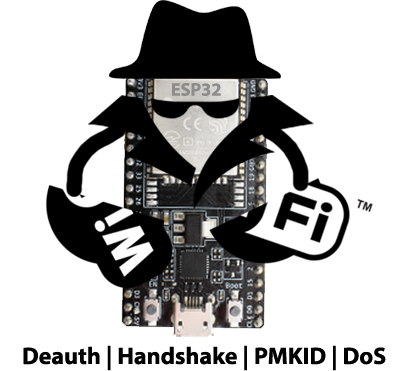
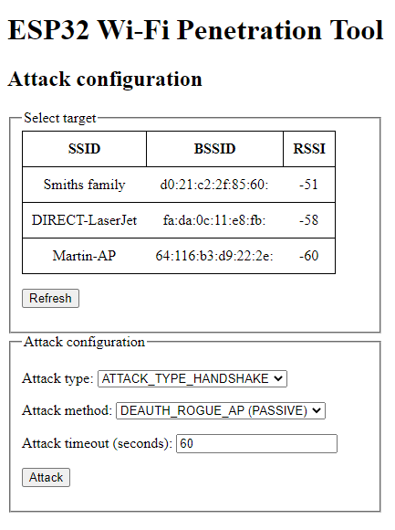

# ESP32 Wi-Fi Sızma Testi Aracı (Wi-Fi Penetration Tool)

Bu proje, ESP32 platformu için çeşitli Wi-Fi saldırılarını gerçekleştirmek amacıyla evrensel bir araç sunar. Wi-Fi saldırılarında yaygın olarak kullanılan bazı ortak işlevleri sağlar ve yeni saldırıların uygulanmasını kolaylaştırır. Ayrıca el sıkışmalarından (handshakes) PMKID yakalama veya sahte ikiz AP (rogue duplicated AP) başlatma ya da doğrudan kimlik doğrulama düşürme (deauthentication) paketleri gönderme gibi çeşitli yöntemlerle Wi-Fi saldırılarını içerir.

Açıkçası şifre kırma (cracking) bu projenin bir parçası değildir, çünkü ESP32 hash'leri etkili bir şekilde kırmak için yeterli güce sahip değildir. Geri kalan işlemler bu küçük, ucuz ve düşük güç tüketimli SoC üzerinde gerçekleştirilebilir.

<p align="center">
    
</p>

## Özellikler
- **PMKID yakalama**
- **WPA/WPA2 el sıkışma (handshake) yakalama** ve ayrıştırma (parsing)
- Çeşitli yöntemler kullanarak **Kimlik Doğrulama Düşürme (Deauthentication) saldırıları**
- **Hizmet Reddi (Denial of Service - DoS) saldırıları**
- Yakalanan trafiği **PCAP formatında** biçimlendirme
- Yakalanan el sıkışmalarını Hashcat tarafından kırılmaya hazır **HCCAPX dosyasına** dönüştürme
- Pasif el sıkışma dinleme (sniffing)
- Yeni saldırıların uygulanması için kolayca genişletilebilir altyapı
- Örneğin akıllı telefon kullanarak hareket halindeyken kolay yapılandırma için Yönetim AP'si (Management AP)
- Ve dahası...

### Demo Video
[](https://www.youtube.com/watch?v=9I3BxRu86GE)


## Kullanım
1. Projeyi ESP32'ye (DevKit veya modül) [derleyin](#Derleme-Build) ve [yükleyin](#Yükleme-Flash).
2. ESP32'ye güç verin.
3. Yönetim AP'si önyüklemeden (boot) sonra otomatik olarak başlatılır.
4. Bu AP'ye bağlanın\
Varsayılan olarak:\
*SSID:* `ManagementAP` ve *şifre:* `mgmtadmin`
5. Tarayıcınızda `192.168.4.1` adresini açın; aracı yapılandırmak ve kontrol etmek için şöyle bir web arayüzü göreceksiniz:

    

## Derleme (Build)
Bu proje şu anda ESP-IDF 4.1 (`5ef1b390026270503634ac3ec9f1ec2e364e23b2` commit'i) kullanılarak geliştirilmiştir. Daha yeni sürümlerde çalışmayabilir.

Proje, olağan ESP-IDF yöntemiyle derlenebilir:

```shell
idf.py build