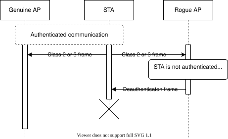

# ESP32 Wi-Fi Sızma Testi Aracı
## Ana (Main) Bileşen

Bu bileşen ana bileşendir (yalancı bileşen / pseudo-component olarak da adlandırılır). Saldırıların kendi uygulamalarını ve saldırı sarmalayıcı (wrapper) altyapısını içerir.

Aşağıdaki saldırı uygulamalarının arkasındaki teori [/doc/ATTACK_THEORY.md](../doc/ATTACKS_THEORY.md) dosyasında yer almaktadır.

### Deauth Yayın (Broadcast)
Kimlik doğrulama düşürme (deauthentication) paketlerini göndermeyi engelleyen Wi-Fi Yığını Kitaplıklarını (Wi-Fi Stack Libraries) baypas ederek bu paketleri göndermenin bir yolu vardır. Bu amaçla [WSL Bypasser](../components/wsl_bypasser) bileşeni kullanılmaktadır. Baypas işleminin nasıl çalıştığı hakkında daha fazla ayrıntı için WSL Bypasser bileşeninin README dosyasına bakın.

Deauthentication çerçevesi, yayın (broadcast) hedef MAC adresi (ff:ff:ff:ff:ff:ff), kaynak MAC adresi ve hedef AP'nin BSSID'si ile oluşturulur.

#### Avantajlar
- Aktif bir iletişimin devam etmesi gerekmez. Cihazlar aktif olarak iletişim kurmasalar bile bu çerçeveyi alacaktır.

#### Dezavantajlar
- [Aircrack-ng dokümantasyonunda](https://www.aircrack-ng.org/doku.php?id=deauthentication#why_does_deauthentication_not_work) belirtildiği gibi, bazı cihazlar yayın deauthentication çerçevelerini yok sayar.
    > Bazı istemciler yayın kimlik doğrulama düşürmelerini yoksayar. Eğer durum buysa, özellikle ilgili istemciye yönelik bir deauthentication göndermeniz gerekecektir.

### Sahte AP (Rogue AP)
Diğer bir seçenek ise sahte ve kopyalanmış bir AP başlatmaktır. Bu sayede Wi-Fi Yığını Kitaplıklarına dokunulmaz ve bunun için yalnızca ESP-IDF API'si kullanılır. AP arayüzüne herhangi bir geçerli MAC adresini atamanın mümkün olduğu göz önüne alındığında, `esp_wifi_set_mac` kullanarak gerçek AP ile aynı MAC adresini ayarlayarak kopyalanmış bir AP oluşturabiliriz. 
AP tarayıcısından gerekli tüm değerleri biliyoruz ve bunları `wifi_ap_record_t` yapısında tutuyoruz. Buradan bilgileri `wifi_config_t` yapısına aktarabilir ve `esp_wifi_set_config` ile AP'yi yapılandırabiliriz. Bu AP başlatıldıktan sonra, herhangi bir STA'dan (istasyon/cihaz) Sınıf 2 veya 3 çerçevesi aldığında, bir deauthentication çerçevesi ile yanıt verecektir. Bu davranış doğrudan 802.11 standardında tanımlanmıştır. STA, çerçevenin gerçek AP'den mi yoksa sahte bir AP'den mi geldiğini doğrulamanın bir yoluna sahip değildir ve savunma amacıyla ağdan kendi kimlik doğrulamasını düşürür (deauthenticates).  
Bu durum aşağıdaki sıra diyagramında (sequence diagram) gösterilmiştir: 

#### Avantajlar
- Kimlik doğrulama düşürme çerçeveleri, AP'ye herhangi bir çerçeve gönderen STA'ya yönlendirilir.

#### Dezavantajlar
- Bu yaklaşım aktif bir iletişimin gerçekleşmesini gerektirir.
- STA'nın kafasını tamamen karıştırabilir, bu nedenle tekrar kimlik doğrulaması yapamayabilir veya gerçek olan yerine sahte AP ile kimlik doğrulaması yapmaya çalışabilir. (Kopyalanmış AP'yi açıp kapatarak ve STA'ya yeniden bağlanması için biraz zaman tanınarak düzeltilebilir).

### PMKID Yakalama
Bir AP'den PMKID yakalamak için yapmamız gereken tek şey bağlantı başlatmak ve AP'den ilk el sıkışma (handshake) mesajını almaktır. Eğer PMKID mevcutsa, AP bunu ilk el sıkışma mesajının bir parçası olarak gönderecektir, bu nedenle kimlik bilgilerini bilmememiz önemli değildir.

### Hizmet Reddi (Denial of Service - DoS) 
Bu yöntem, yukarıdaki deauthentication yöntemlerini yeniden kullanır ve yalnızca el sıkışma yakalama adımını atlar. Ayrıca tüm deauth yöntemlerinin kombinasyonuna izin verir; bu da onu çeşitli cihazların farklı davranışlarına karşı daha dayanıklı hale getirir.

## Referans
Doxygen API referansı `main` klasörünün içindeki README'de mevcuttur.